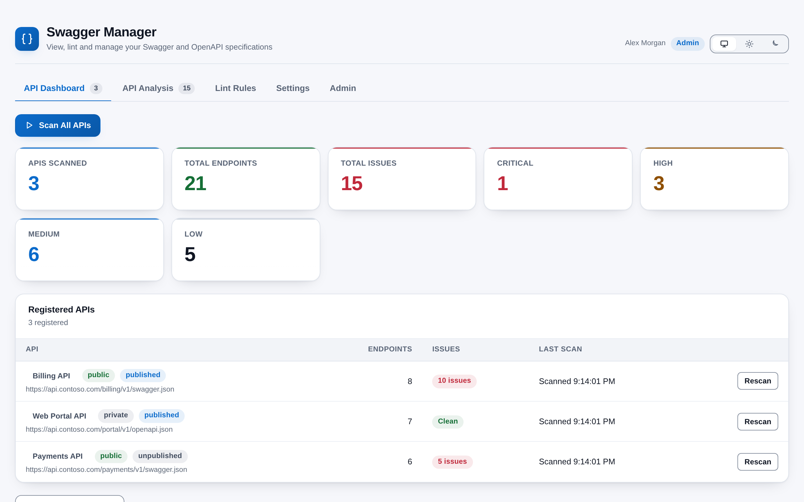
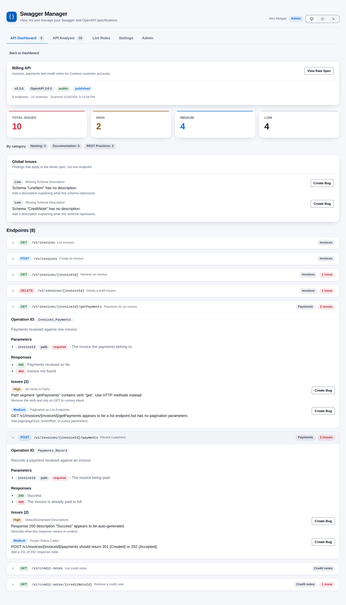
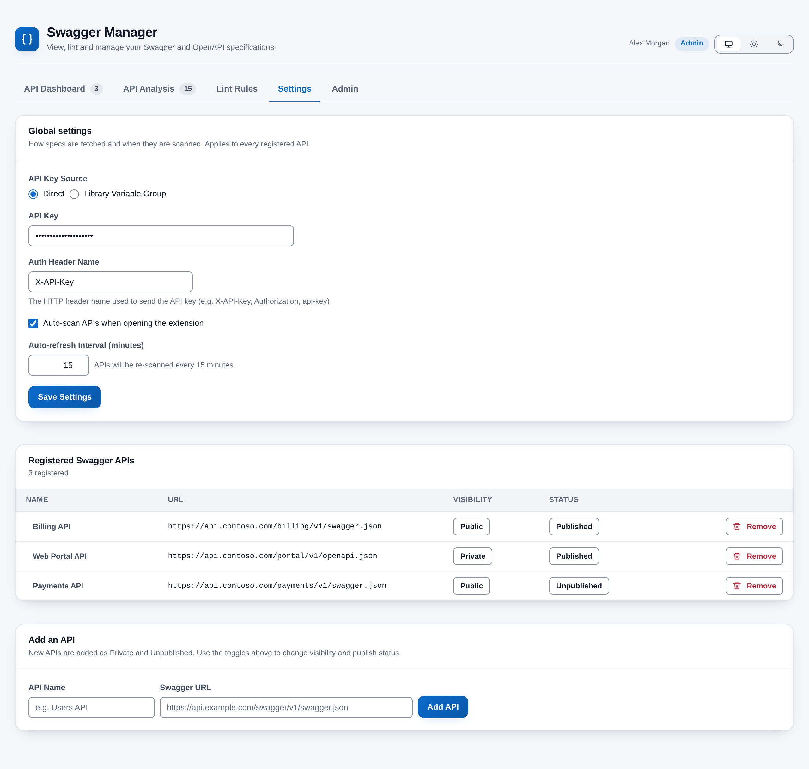
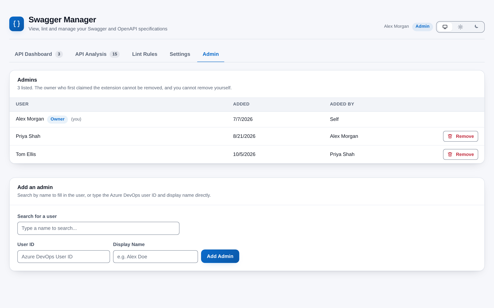

# Swagger Manager

[](https://github.com/adam-wheater/azure-devops-swagger-manager/actions/workflows/ci.yml)

An Azure DevOps extension that checks your **Swagger / OpenAPI specifications** for problems before an API ships. Register your spec URLs, or discover them in your repositories, and it fetches each spec in your browser, runs 27 built-in lint rules (naming, REST practice, documentation and publishing policy) and shows the result as a dashboard, a filterable analysis and a per-endpoint detail view, with a one-click way to raise a Bug from any finding. It is built for API owners, platform teams and tech leads who want one question answered: *is this spec consistent, documented and safe to publish?* Everything runs in the browser from a hub under **Pipelines > Swagger Manager**. The first person to open it claims admin, and only admins can change settings.



## Table of contents

- [Getting started](#getting-started)
- [Features](#features)
- [Screens](#screens)
  - [Header and tabs](#header-and-tabs)
  - [Access gate](#access-gate)
  - [API Dashboard tab](#api-dashboard-tab)
  - [API detail view](#api-detail-view)
  - [API Analysis tab](#api-analysis-tab)
  - [Create Bug dialog](#create-bug-dialog)
  - [Lint Rules tab](#lint-rules-tab)
  - [Settings tab](#settings-tab)
  - [Admin tab](#admin-tab)
- [How it works](#how-it-works)
- [Settings](#settings)
- [Rules and detection logic](#rules-and-detection-logic)
  - [Naming (8 rules)](#naming-8-rules)
  - [REST practices (9 rules)](#rest-practices-9-rules)
  - [Documentation (8 rules)](#documentation-8-rules)
  - [Policy (2 rules)](#policy-2-rules)
- [Scopes & permissions](#scopes--permissions)
- [Privacy](#privacy)
- [Troubleshooting and known limitations](#troubleshooting-and-known-limitations)
- [Development](#development)
- [Project structure](#project-structure)
- [Tech stack](#tech-stack)
- [Contributing](#contributing)
- [License](#license)

## Getting started

1. Install **Swagger Manager** from the Visual Studio Marketplace (publisher `adam-wheater`): <https://marketplace.visualstudio.com/items?itemName=adam-wheater.swagger-manager>. The listing carries the **Preview** flag. An organization administrator must approve the install.
2. Open any project and go to **Pipelines**. The hub appears as **Swagger Manager** at the end of the Pipelines hub group (`ms.vss-build-web.build-release-hub-group`, order 99).
3. **First run:** the first person to open the hub sees the setup page and can press **Claim Admin**. Until then nobody can register APIs.
4. In **Settings**, add your spec URLs, or use **Discover APIs in Repositories** on the dashboard. Set the API key and header name if your endpoints need one.
5. Press **Scan All APIs**, then open an API to see its endpoints and findings.

## Features

- **Multi-API dashboard** -- Register any number of spec URLs, scan them all at once and see APIs scanned, endpoints, total issues and the severity breakdown at a glance.
- **27 built-in lint rules** -- 8 naming, 9 REST practice, 8 documentation and 2 policy rules. Every rule can be switched off or given a different severity (Critical, High, Medium, Low).
- **Placeholder description detection** -- 23 patterns catch generated or empty text such as "Success", "OK", "Returns a list of" and "A server side error occurred." in operation, summary and response descriptions.
- **Swagger 2.0 and OpenAPI 3.x** -- Specs can be JSON or YAML; the format is detected from the response, and a spec without a `paths` object is rejected with a clear message.
- **Discovery** -- Admins can scan every Git repository in the project for spec files (a `.json`, `.yaml` or `.yml` file whose name contains `swagger` or `openapi`) and import them as registered APIs in one click.
- **Detail and analysis views** -- Browse every endpoint with its parameters, responses and findings, or filter all findings of an API by severity, category and free text, grouped by path with the worst first.
- **Bugs from findings** -- Raise an Azure DevOps Bug from any finding with a pre-filled title, HTML description, mapped severity and priority, area path and an optional parent work item. The bug is linked back from the finding.
- **Publishing policy** -- Mark APIs Public or Private and Published or Unpublished. A policy rule raises a Critical finding for a 0.x version that is public or published.
- **First-claim admin model** -- The first person to open the extension claims admin and can add more admins. Everyone else gets a read-only view. The original claimer can never be removed.
- **Keys from a variable group** -- The API key sent to spec hosts can be typed in or read at scan time from a Library variable group.
- **Scan control** -- Scans run three APIs at a time, a full scan can be cancelled, and report a failing API inline without stopping the others. Optional scan on load and a periodic re-scan.
- **Stored summaries** -- Per-API scan summaries are saved, so the dashboard shows the last known counts after a reload and warns when they are more than 24 hours old.
- **Theme follows Azure DevOps** -- Light, dark and high-contrast host themes are detected from the SDK's `themeApplied` event, with a manual Azure DevOps / Light / Dark override in the header.
- **WCAG AA contrast** -- Every text and control colour pair in the design system is audited to 4.5:1 (text) and 3:1 (UI) in both palettes; severities always carry a text label, never colour alone.
- **Error boundary** -- Rendering failures show a "Try again" button instead of a blank hub, and an SDK handshake failure renders a plain-text diagnostic.

## Screens

### Header and tabs

The header is the shared `AppShell`: brand mark and product name on the left, your display name, an **Admin** or **Read-only** pill and the theme toggle (Azure DevOps / Light / Dark) on the right. The **API Dashboard**, **API Analysis** and **Lint Rules** tabs are for everyone; **Settings** and **Admin** exist only for admins. Opening an API from the dashboard shows its detail view with the **API Dashboard** tab still highlighted.

### Access gate

Before any tab renders, `App` decides what to show.

| Situation | What you see |
|-----------|--------------|
| Admin state or settings still loading | A centred "Loading Swagger Manager" card with a busy indicator |
| No admin document exists | **Swagger Manager setup**: an explanation, "Signed in as *your name*" and a **Claim Admin** button. Claiming creates the `admin` document with you as owner and admin. If the claim fails (for example someone claimed it a moment earlier) an error banner "Could not claim admin" shows the reason |
| You are on the admin list | The full app with the **Admin** pill and every tab |
| You are not on the admin list | The app in read-only mode with the **Read-only** pill and a dismissible info banner, "Read-only access": you can browse APIs, scan results and lint rules but cannot register APIs, change settings or create bugs. The **Settings** and **Admin** tabs are hidden |
| Settings cannot be read | A red banner under the tabs with the error text. Only a 404 counts as "no document"; any other failure (network, expired token, server error) shows the banner and the read-only app, never the claim page |

Read-only users can still press **Scan All APIs** and **Scan**: a scan writes only scan results (summaries, findings and each API's last-scan fields), never configuration. They cannot discover or import APIs, see the Settings and Admin tabs, change lint rules (the controls are disabled and there is no Save) or see **Create Bug** buttons. This is a user-interface guard, see [Troubleshooting and known limitations](#troubleshooting-and-known-limitations).

### API Dashboard tab

The default tab. The tab label carries the number of registered APIs.

- **No APIs registered.** An empty state reads "No Swagger APIs registered yet." For admins it offers **Discover APIs in Repositories** (the button reads "Scanning Repositories..." while it runs) and mentions adding specs by hand in Settings. Non-admins see "Contact an admin to register Swagger API endpoints."
- **Scan controls.** **Scan All APIs** (primary) starts a scan of every registered API. While a scan runs the button is replaced by a busy "Scanning..." button and a red **Cancel** button, and a progress bar shows the phase ("Scanning Users API", "Scanned Users API") with a count such as 2 / 3. Per-row **Scan** buttons are disabled during a scan. **Cancel** stops a full scan only; a scan of a single API (a row **Scan**, or the automatic scan of a newly added API) runs to the end.
- **Stale warning.** When no scan has run in this visit and the stored summaries are loaded, a warning banner appears if the oldest summary is more than 24 hours old: "Scan data is more than 24 hours old. Click "Scan All APIs" to refresh."
- **Summary tiles.** APIs Scanned, Total Endpoints and Total Issues (red when above zero, green at zero), then one tile each for Critical, High, Medium and Low when that count is above zero. Live results from this visit take precedence; stored summaries are used only when there are none.
- **Registered APIs table.**

| Column | Content |
|--------|---------|
| API | The name as a button that opens the API, a visibility pill (public or private), a publish pill (published or unpublished), the spec URL, and an inline red message if the last scan of that API failed |
| Endpoints | The endpoint count from the live scan or the stored summary, `-` when unknown |
| Issues | A **Clean** (green) or "*n* issues" (red) pill. For stored summaries a line such as "1 critical · 2 high" |
| Last scan | "Scanned *time*" for a live scan, "Last scan: *date and time*" for a stored one, or "Not scanned yet" |
| Actions | **Scan**, or **Rescan** once this visit has a result for the API |

Clicking an API name opens its [detail view](#api-detail-view) if it has a result from this visit, otherwise the [Analysis tab](#api-analysis-tab) with that API selected.

- **Discovery (admins).** **Discover More APIs** scans the Git repositories of the current project and lists every matching file in a "Discovered Swagger/OpenAPI specs" table: repository, file path, suggested name and **Import**. Importing registers the API as Private and Unpublished and removes it from the list; a spec whose URL is already registered shows a disabled **Added**.

### API detail view



Opened from the dashboard for an API scanned in this visit. **Back to Dashboard** returns.

- **Header card.** The spec title, its `info.description`, **View Raw Spec** / **Hide Raw Spec** (a scrollable, pretty-printed JSON card), and pills for the version (`v1.2.0`), the format ("OpenAPI 3.0.1", "Swagger 2.0" or "Unknown"), visibility and publish status, followed by "*n* endpoints · *n* schemas · Scanned *date and time*". Schemas are counted from `components.schemas`, or `definitions` for Swagger 2.0.
- **Issue summary.** A green "No issues found - this API is clean!" banner, or tiles for Total Issues and each non-zero severity, plus a "By category" row of pills (for example "Naming: 3").
- **Global Issues.** Findings whose path is `(global)` or starts with `#/` (spec-level and policy rules, and per-schema findings).
- **Endpoints.** One collapsible row per HTTP method and path: a method pill (GET green, POST blue, PUT amber, PATCH accent, DELETE red, OPTIONS and HEAD grey), the path in monospace, the summary, the tags and an "*n* issues" pill. Expanding a row shows the operation ID, the description, the parameters (name, location, a **required** pill and description), the responses (status pill: 2xx green, 4xx and 5xx red, other grey, with the description or "(no description)") and the findings for that method and path.
- **Findings.** Each shows a severity pill, the rule name, the message and the suggestion. Admins see **Create Bug**; once a bug exists the button is replaced by a "Bug #*id*" link that opens the work item in a new tab.

Findings that belong to a path but not to one method (casing, plurality, trailing slash, nesting depth and the like) are counted in the totals and shown in the Analysis tab, but this view lists only method-level and global findings.

### API Analysis tab

The tab label carries the total number of findings across the APIs scanned in this visit. Only APIs with a live result can be analysed; with none it shows "No scan results yet." and asks you to scan from the dashboard first.

- **Toolbar.** An API selector (each option shows its issue count, for example "Users API (14 issues)"), a severity filter, a category filter, a search box (matches path, message, rule name and HTTP method) and a count such as "12 of 47 issues".
- **Specification card.** Title, version, spec version and endpoint count.
- **Findings.** Grouped by path, ordered by worst severity first. Each group is a collapsible row with the path and an "*n* issues" pill coloured by the worst severity in the group. Expanding it lists each finding with its severity pill, method pill, rule name, message and suggestion. When filters hide everything, or the API is clean, an empty state says so.

### Create Bug dialog

Opened from **Create Bug** on a finding (admins only). A banner at the top repeats the severity, rule and message.

| Field | Behaviour |
|-------|-----------|
| Title | Pre-filled as `[Swagger Lint] <rule name>: <path> (<METHOD>)`; required |
| Area Path | A dropdown of the project's area paths (loaded to a depth of 5; the first is selected). If none can be loaded it becomes a free-text field |
| Parent Work Item ID | Optional number. When set, the bug is linked as a child of that work item (Feature, Epic or PBI) with the `System.LinkTypes.Hierarchy-Reverse` relation. A non-numeric value is rejected with "Parent ID must be a number." |

The bug is created as a `$Bug` in the current project with:

| Lint severity | Bug severity | Priority |
|---------------|--------------|----------|
| Critical | 1 - Critical | 1 |
| High | 2 - High | 2 |
| Medium | 3 - Medium | 3 |
| Low | 4 - Low | 4 |

Tags are set to `swagger-lint`. The description is an HTML body with the API name, rule, category, severity, path, method, message and suggestion; every value taken from the spec is HTML-escaped first. The dialog is a modal with a focus trap: Escape or **Cancel** closes it. After creation the mapping from the finding key (`ruleId::path::METHOD`) to the bug is stored, so the "Bug #*id*" link survives page reloads for that finding.

### Lint Rules tab

The tab label carries the number of saved rule overrides. The card is titled "Lint Rules (27)".

- **Filters.** A search box (matches rule name, description and rule ID) and a category selector.
- **Tables.** One table per category (Naming, REST Practices, Documentation, Policy) with an **On** checkbox, the rule name and description (with a **modified** pill when the rule differs from its defaults), and the current severity pill. Admins also get a severity selector per rule.
- **Admin actions.** **Reset to Defaults** clears every override locally. **Save** writes the full override list and shows **Saved!**; its label counts unsaved changes against what is stored, for example "Save (3 changed)". The new rules apply from the next scan.
- **Read-only.** Non-admins see the same tables with the checkboxes disabled and no selectors, Reset or Save.

### Settings tab



Admins only. Three cards.

**Global settings** (applies to every registered API):

| Field | Behaviour |
|-------|-----------|
| API Key Source | **Direct** (type the key) or **Library Variable Group** (read it at scan time) |
| API Key | A password field, shown for Direct |
| Variable Group, Variable Name, **Refresh** | For Library Variable Group. Groups of the current project are loaded when you choose it; picking a group fills the variable list. Secret variables cannot be read through the API |
| Auth Header Name | The HTTP header that carries the key. Defaults to `X-API-Key` |
| Auto-scan APIs when opening the extension | One full scan when the hub opens |
| Auto-refresh Interval (minutes) | 0 to 60; 0 disables it. The label restates the effect |
| **Save Settings** | Saves and shows **Saved!**. Saving Library Variable Group clears the stored key; saving Direct leaves any earlier variable group choice stored but unused |

**Registered Swagger APIs:** a table with the name (click to rename inline; Enter saves, Escape cancels), the URL, a **Public/Private** toggle, a **Published/Unpublished** toggle and **Remove**, which asks for confirmation.

**Add an API:** a name and a URL. The URL must parse as a URL ("Invalid URL format."), both fields are required ("Both name and URL are required.") and a URL that is already registered is refused. New APIs are added as Private and Unpublished.

### Admin tab



Admins only. Two cards.

**Admins** lists each admin: the display name with an **Owner** pill for the original claimer and "(you)" for yourself, the date added and who added them ("Self", or the name of the admin who added them; their user ID once they are no longer an admin). **Remove** asks for confirmation and is not offered for the owner or for yourself.

**Add an admin** has a search box and two fields:

- **Search for a user** starts after two characters and a 300 ms pause. It calls `_apis/identities` on your organization and lists matches as "Display Name (account)"; choosing one fills the two fields below.
- **User ID** and **Display Name** can also be typed by hand. Both are required ("Both User ID and Display Name are required."). Adding a user who is already an admin shows the service error.

## How it works

```
+------------------+      +------------------------+      +------------------------+
|  Hub loads       | ---> |  useAdmin              | ---> |  Extension Data        |
|  SDK.init()      |      |  AdminService          |      |  Service               |
|  SDK.ready()     |      |  getDocument "admin"   |      |  SwaggerManager-       |
|  SDK.getUser()   |      |  claim / add / remove  |      |  Settings              |
+------------------+      +------------------------+      +------------------------+
                                     |  claimed
                                     v
                          +------------------------+      +------------------------+
                          |  useSwaggerSettings    | ---> |  global-settings       |
                          |  SwaggerSettingsService|      |  swagger-apis          |
                          |  (KeyedMutex per doc)  |      |  lint-rule-overrides   |
                          +------------------------+      +------------------------+
                                     |
                      [Scan All APIs] / [Scan] / auto-scan / timer
                                     v
                          +------------------------+      +------------------------+
                          |  SwaggerFetchService   | ---> |  your spec URL         |
                          |  JSON or YAML, key     |      |  (or an Azure DevOps   |
                          |  header or bearer      |      |  _apis items URL)      |
                          +------------------------+      +------------------------+
                                     |
                                     v
                          +------------------------+      +------------------------+
                          |  SwaggerLinter         | ---> |  Dashboard, Analysis,  |
                          |  27 rules, 4 levels    |      |  Detail (React state)  |
                          +------------------------+      +------------------------+
                                     |  summaries, findings
                                     v
                          scan-summaries, scan-findings, swagger-apis (last scan fields)
```

1. **SDK init.** `src/SwaggerManager/SwaggerManager.tsx` calls `SDK.init()` then `SDK.ready()`, mounts `<ThemeProvider><App/></ThemeProvider>` and imports `styles/app.css`. If the handshake rejects, a plain-DOM message and the error text are written into `#root` instead.
2. **Admin state.** `useAdmin` reads the user from `SDK.getUser()` (id and display name) and loads the `admin` document through `AdminService`. Only a 404 (no document yet) means the extension is unclaimed; any other read failure shows an error and keeps the claim page hidden.
3. **Settings.** `useSwaggerSettings` loads the global settings, the registered APIs and the rule overrides in parallel. A missing document (404) is created with defaults on first read; a failed read is an error and writes nothing.
4. **Scan.** For each API the app resolves the key (typed key, or the value of the chosen variable group variable), then `SwaggerFetchService.fetchSpec` requests the URL. A per-API key and header, when stored on the entry, override the global ones. URLs on `dev.azure.com` or `*.visualstudio.com` whose path contains `/_apis/` get an `Authorization: Bearer` header from `SDK.getAccessToken()` instead of the key.
5. **Parse.** A JSON or text/JSON content type is parsed as JSON. Anything else is tried as JSON, then YAML (`js-yaml`). A response without a `paths` field is rejected.
6. **Lint.** `SwaggerLinter.lint` runs every enabled rule at four levels (operation, path, spec, policy), applies severity overrides, sorts Critical first and removes duplicates. Policy rules run only when the API entry is known.
7. **Concurrency.** `handleScanAll` processes the registered APIs in batches of 3 with `Promise.all`, sharing one `AbortController`. **Cancel** aborts in-flight requests and skips the remaining batches. A failing API is recorded as `Failed to scan <name>: <reason>` and the batch continues.
8. **Persistence.** After each scan the summary (endpoint count, counts per severity, total), the full finding list and the API's last-scan fields are written. Writes to one document are serialised by `KeyedMutex`.
9. **Automatic scans.** If auto-scan on load is on, one full scan starts when the hub opens. Registering or importing an API starts a scan of that API, unless a scan is already running or it is the very first API ever registered. If an auto-refresh interval above 0 is set, a full scan starts on that timer whenever no scan is running.

## Settings

Everything the extension stores. Documents live in the Extension Data Service collection `SwaggerManagerSettings`, at the default (collection-wide) scope, so they are shared by everyone in the organization and every project. Each carries a `version` field (currently 1); nothing migrates on it yet.

| Document | Contents | Default on first read |
|----------|----------|-----------------------|
| `global-settings` | `apiKey`, `authHeaderName`, `autoScanOnLoad`, `refreshIntervalMinutes`, `apiKeySource`, `variableGroupRef` | Empty key, `X-API-Key`, auto-scan **on**, refresh every **5** minutes, Direct |
| `swagger-apis` | Registered APIs: id, name, URL, who and when added, visibility, publish status, last-scan fields, optional per-API `apiKey` and `authHeaderName` | No APIs |
| `lint-rule-overrides` | Rule ID with `enabled` and an optional `severity`. Saved as a complete replacement | No overrides: every rule on at its default severity |
| `scan-summaries` | Per API: scan time, endpoint count, counts per severity, total | None |
| `scan-findings` | Per API: the full finding list and scan time. Written after every scan; the interface does not read it back | None |
| `bug-mapping` | Finding key to bug ID and URL | None |
| `admin` | Who claimed, when, and the admin list with who added each | None: unclaimed |

The first read of `global-settings` therefore turns auto-scan on and the 5-minute refresh on; an admin can change both in Settings. Per-API keys are part of the model and honoured when a spec is fetched, but the interface has no field for them.

The only other stored value is your theme choice (`light` or `dark`), in the browser under the `localStorage` key `swagger-manager.theme`. If storage is blocked the choice does not persist.

## Rules and detection logic

The linter ships 27 rules. Each has a default severity, can be switched off and can be given another severity by an admin. Rules run at four levels:

| Level | Runs | Findings carry |
|-------|------|----------------|
| Operation | For every path and HTTP method (get, post, put, patch, delete, options, head) | The path and the method |
| Path | Once per path | The path only |
| Spec | Once per spec | The path `(global)`, a path `#/schemas/<name>`, or (for operation IDs) the path and method |
| Policy | Once per spec, only when the API entry is known | The path `(global)` |

Findings are sorted Critical, High, Medium, Low and de-duplicated on rule, path, method and message.

### Naming (8 rules)

| Rule ID | Level | Flags | Default |
|---------|-------|-------|---------|
| `naming-camelcase-params` | Path | A `{parameter}` that does not match `^[a-z][a-zA-Z0-9]*$` | Medium |
| `naming-plural-resources` | Path | The last non-parameter segment when it is not plural. A word counts as plural if it ends in "s", is one of 21 singular exceptions (`auth`, `login`, `health`, `status`, `search`, `me`, `info`, `config` and similar), is one of 75 listed singular words ending in "s" (`address`, `status`, `analysis` and similar), or is `data`, `media`, `criteria`, `people` or `children` | Medium |
| `naming-no-verbs-in-paths` | Operation | A segment equal to a CRUD verb, or starting with one followed by an uppercase letter (`getUsers`, `createOrder`). The 17 verbs are get, list, fetch, retrieve, read, create, add, insert, post, update, edit, modify, put, patch, delete, remove, destroy. Kebab-case forms such as `get-users` are not caught | High |
| `naming-no-trailing-slash` | Path | A path longer than `/` that ends in `/` | Low |
| `naming-kebab-case-paths` | Path | A segment that is not kebab-case; version segments such as `v1` are skipped | Medium |
| `naming-no-file-extensions` | Path | A segment ending in `.json`, `.xml`, `.html`, `.yaml`, `.yml`, `.csv`, `.pdf` or `.txt` | Medium |
| `naming-no-crud-operation-ids` | Spec | An `operationId` that starts with one of the same 17 verbs (case-insensitive prefix, so `addressLookup` is flagged for "add") | Low |
| `naming-consistent-casing` | Path | A path with two or more non-version segments that mixes camelCase, snake_case and kebab-case | Medium |

### REST practices (9 rules)

| Rule ID | Level | Flags | Default |
|---------|-------|-------|---------|
| `rest-correct-http-verbs` | Operation | A GET whose path has a segment `create`, `add` or `insert` (use POST), `delete` or `remove` (use DELETE), or `update`, `edit` or `modify` (use PUT or PATCH) | High |
| `rest-no-body-on-get-delete` | Operation | A GET or DELETE with a `requestBody`, or a Swagger 2.0 `in: body` parameter | High |
| `rest-body-on-post-put-patch` | Operation | A POST, PUT or PATCH with neither | Medium |
| `rest-proper-status-codes` | Operation | A POST with neither 201 nor 202, a DELETE with neither 204 nor 200 | Medium |
| `rest-pagination-on-lists` | Operation | A GET whose path ends in a resource (not a parameter) and has no parameter named `page`, `pageSize`, `page_size`, `limit`, `offset`, `skip`, `take`, `cursor`, `per_page` or `perPage` | Medium |
| `rest-versioning` | Spec | No path contains `/v<number>/` | Low |
| `rest-no-deep-nesting` | Path | More than 3 non-parameter segments, counting any `api` or version segment | Medium |
| `rest-content-type-defined` | Operation | A POST, PUT or PATCH whose OpenAPI 3 `requestBody` has no `content` | Medium |
| `rest-consistent-error-format` | Spec | More than 3 distinct response schemas across all 4xx and 5xx responses | Low |

### Documentation (8 rules)

| Rule ID | Level | Flags | Default |
|---------|-------|-------|---------|
| `docs-default-descriptions` | Operation | An operation description, summary or response description that matches one of 23 placeholder patterns: `Success`, `OK`, `successful operation`, `Returns a list of ...`, `Returns the ...`, `Gets the ...`, `Gets a list of ...`, `Creates a new ...`, `Updates an existing ...`, `Deletes an existing ...`, `No content`, `Bad request`, `Not found`, `Unauthorized`, `Forbidden`, `Internal server error`, `Server error`, `Error`, `Default response`, `A server side error occurred.`, and empty text | High |
| `docs-missing-operation-description` | Operation | Neither a description nor a summary | High |
| `docs-missing-parameter-description` | Operation | A parameter without a description (a `$ref` parameter is skipped) | Medium |
| `docs-missing-response-description` | Operation | A response without a description | Medium |
| `docs-missing-schema-description` | Spec | A schema in `components.schemas` or `definitions` without a description | Low |
| `docs-missing-examples` | Operation | An operation that has responses but no `example` on any response media type or its schema | Low |
| `docs-missing-tags` | Operation | No tags | Medium |
| `docs-empty-summary` | Operation | A `summary` key that is present but empty or only whitespace | Medium |

### Policy (2 rules)

| Rule ID | Level | Flags | Default |
|---------|-------|-------|---------|
| `policy-version-not-production` | Policy | `info.version` has major version 0 (a leading `v` is ignored) and the API is Public or Published | Critical |
| `policy-missing-api-description` | Policy | `info.description` is missing, empty, or one of `No description`, `TODO`, `TBD`, `Description` (case-insensitive, optional trailing full stop) | High |

References are not resolved: a `$ref` in place of a parameter, response or schema is treated as it appears in the document, not as the object it points to.

## Scopes & permissions

| Scope | Why it is requested | Concrete calls |
|-------|---------------------|----------------|
| `vso.project` | Resolve the current project | `IProjectPageService.getProject` (used by discovery, variable groups, bug creation and area paths) |
| `vso.work_write` | Create Bug work items and read area paths | `POST _apis/wit/workitems/$Bug`, `GET _apis/wit/classificationnodes/areas` |
| `vso.variablegroups_read` | Read variable groups for the key source | `TaskAgentRestClient.getVariableGroups`, `getVariableGroup` |
| `vso.code` | Find and read spec files in repositories | `GitRestClient.getRepositories`, `getItems`, and the `_apis/git/repositories/<id>/items` URLs that discovery registers |
| `vso.identity` | Find people by name when an admin grants admin to someone else | `GET _apis/identities?searchFilter=General` |

The Extension Data Service calls (`getDocument`, `setDocument`) use the token from `SDK.getAccessToken()`; no `vso.extension.data` scope is declared. The identity search calls `_apis/identities` with that token, which is what `vso.identity` is for. If the call fails, the search returns nothing and the User ID and Display Name fields still work.

## Privacy

Everything runs inside the Azure DevOps web UI, in the extension's iframe. There is no backend and no telemetry. The extension talks to three kinds of host: the REST API of the Azure DevOps organization it is installed in, the spec URLs your admins register, and nothing else. Spec content is held in browser memory for the visit; a summary and the findings are stored as described under [Settings](#settings).

What is stored, and where:

- **Extension Data Service**, collection `SwaggerManagerSettings`, for your organization: the documents listed under [Settings](#settings), including the admin list (user IDs and display names).
- **Your API key**, if you choose the Direct key source, is saved as plain text in the `global-settings` document, readable by anything that can read the extension's data. The Library Variable Group source stores only the group and variable name, and reads the value at scan time. A per-API key, if one is ever stored on an entry, is saved the same way.
- **Your browser**: the theme choice under `localStorage` key `swagger-manager.theme`.

The API key header is sent to the spec URL you registered, so register only hosts you trust with that key. For Azure DevOps `_apis` URLs the extension sends its own bearer token instead of the key.

## Troubleshooting and known limitations

| Symptom / limitation | Explanation |
|----------------------|-------------|
| "Failed to scan *name*: Failed to fetch" | The browser could not complete the request. The spec host must allow cross-origin requests from the Azure DevOps page (CORS), be reachable from your machine and be served over HTTPS (an HTTP URL is blocked as mixed content). Hosts behind a VPN are reachable only if you are on it |
| "Failed to fetch Swagger spec from *url*: 401 / 403" | The key or header name is wrong or missing. Check Settings. Only a header key is supported; there is no OAuth or basic auth |
| "does not appear to be a valid OpenAPI/Swagger spec (no "paths" field)" | The URL returned something that parsed but has no `paths` object, often an HTML sign-in page or a spec index |
| "is not valid JSON or YAML" | The response could not be parsed. A response labelled `application/json` that is not valid JSON fails with the parser's own message |
| "Could not read variable ... The variable may be secret or missing." | The Library variable is secret (its value cannot be read through the API), was deleted, or the group was renamed. Use a non-secret variable or the Direct key source |
| Scan seems stuck | Requests have no timeout of their own; a host that never answers waits until the browser gives up. Press **Cancel** |
| Cancel does nothing during a single-API scan | **Cancel** aborts the shared controller of **Scan All APIs** only. A row **Scan** or the automatic scan of a newly added API has no controller, so it runs until the request finishes or the browser gives up |
| Cancel does not discard results | Cancel aborts in-flight requests and skips the remaining batches. APIs that already finished keep their results |
| The first API I added was not scanned automatically | A newly registered or imported API is scanned automatically only when at least one API was already registered |
| The extension scans by itself | On the first read the settings seed auto-scan on load **on** and a 5-minute refresh. Turn both off in Settings (interval 0) |
| Analysis and Detail are empty after a reload | Results are held in memory. The dashboard shows the stored summaries, but you must scan again to open an API's detail or analysis. The full findings are stored but not read back |
| The dashboard counts more issues than the detail view shows | Findings tied to a path but not to one method (casing, plurality, trailing slash, file extensions, nesting, camelCase parameters) are counted but listed only in the Analysis tab |
| "Added" import is disabled for a spec I want twice | Duplicate detection compares the URL string exactly; the same spec under a different URL registers as a second API |
| Discovery finds nothing | Only the default branch is read. A file matches only if its name contains `swagger`, `openapi`, `open-api` or `open_api` and ends in `.json`, `.yaml` or `.yml`, and any path that passes through `node_modules`, `bin`, `obj`, `dist`, `out`, `packages`, `vendor`, `.git`, `.vs`, `.idea` or `__pycache__` is skipped. Disabled and unreadable repositories are skipped silently. The whole tree of every repository is requested, so large repositories are slow |
| Discovery on Azure DevOps Server | Only `dev.azure.com` and `*.visualstudio.com` URLs are recognised as internal and given the bearer token, so imported specs on an on-premises server are fetched without it (not tested) |
| Lint results look wrong for `$ref` | References are not resolved. A `$ref` parameter is skipped by the parameter description and pagination rules; a `$ref` response with no inline description is reported as having none |
| `addressLookup` is flagged by the operation ID rule | The rule is a case-insensitive prefix match on 17 verbs, so any ID that starts with `add`, `get`, `read`, `list` and so on is flagged, even mid-word |
| Plural rule misses `/user` style paths with an "s" | A last segment that ends in "s", is on the exception lists, or is `data`, `media`, `criteria`, `people` or `children` passes. The rule is a heuristic, not a dictionary |
| `rest-versioning` fires on `/api/v2` | The rule looks for `/v<number>/` with a slash after the number; a path that ends in `/v2` does not count |
| Read-only users can still do things | Read-only mode hides controls but is enforced by the interface only. Anyone who can open the hub can use the same Extension Data Service calls. Treat the admin model as a guard against accidents, not a security boundary |
| A red banner instead of the app or the setup page | A document read failed for a reason other than "not found" (network, expired token, server error). Nothing is re-created or overwritten on a failed read; reload once the connection is back |
| Two people claimed admin at once | The claim is written with `createDocument`, which the server refuses when the document already exists, so only the first claim lands; the second sees "Admin has already been claimed" |
| Bug creation fails with a field or type error | The Bug is created with the `Microsoft.VSTS.Common.Severity` and `Priority` fields, so the project needs a Bug work item type that has them (Agile, Scrum and CMMI do; the Basic process has no Bug type) |
| Bug link opens the wrong page | The link uses `_links.html.href` from the create response, falling back to the REST `url` |
| Parent ID "12abc" is accepted as 12 | The field is parsed with `parseInt`, so trailing text after leading digits is ignored |
| Identity search shows nothing | Older versions did not request `vso.identity`, so the search could not work. After updating, an organization admin must approve the new scope in **Organization settings > Extensions**. Until then, type the User ID and Display Name instead |
| Schema count differs from your tooling | Schemas are counted from `components.schemas` or `definitions` only |
| Theme choice does not persist | `localStorage` can be blocked inside the extension iframe; the app falls back to following the Azure DevOps theme |
| High contrast detected (or not) incorrectly | High contrast is a heuristic on pure black/white primary and secondary text plus `forced-colors`. In that mode the theme toggle is hidden on purpose |
| "Swagger Manager could not connect to Azure DevOps" | `SDK.init()` failed. Refresh the page |
| Re-consent | If a future version changes the requested scopes, organization administrators must re-authorize the extension under **Organization settings > Extensions** |

## Development

### Prerequisites

- Node.js 20 or later (`engines.node >= 20`)
- npm; install with `npm install --legacy-peer-deps`

### npm scripts

| Script | What it does |
|--------|--------------|
| `npm run build` | Production webpack build into `dist/`; `postbuild` runs `scripts/verify-bundle.js`, then `scripts/third-party-notices.js` |
| `npm run build:dev` | Development build with source maps (CSS is still extracted so the hand-written stylesheet link is exercised) |
| `npm run screenshots` | Builds the hub on sample data and saves the screenshots to `static/screenshots/` (see below) |
| `npm run verify:bundle` | Run the `dist/` sanity check on its own |
| `npm run package` | `tfx extension create` -> `out/*.vsix` |
| `npm test` | Jest, both projects, verbose |
| `npm run lint` / `npm run lint:fix` | ESLint over `src/` and `tests/` (flat config, Prettier-compatible) |
| `npm run format` / `npm run format:check` | Prettier write / check over `src/` and `tests/` |
| `npm run publish:marketplace` | `tfx extension publish` with the manifest |

### Run it locally with sample data

`demo/` builds the real hub against stand-ins for the Azure DevOps SDK and REST clients, filled with a fictional "Contoso" project: three registered APIs whose specs are served by a stand-in for `fetch`, and Alex Morgan as the admin. Use it to try the UI without an organization, and to refresh the screenshots:

```sh
npm i --no-save playwright && npx playwright install chromium   # once
npm run screenshots
```

After that, open `demo/dist/SwaggerManager/SwaggerManager.html` in a browser to click around. `demo/api.ts` holds the sample data and `demo/shots.json` lists the screenshots; the other files in `demo/` are the same in every extension. Nothing in `demo/` ships in the package.

### Release build (`build.ps1`)

`build.ps1` is the same script in every repository of this extension family. It runs the CI checks locally in the same order, then versions, builds and packages:

1. `npm ci --legacy-peer-deps` (the same install as CI)
2. `npm run lint`
3. `npm run format:check`
4. `npm test`
5. Bump the version in `vss-extension.json`, `package.json` and `package-lock.json`
6. `npm run build` (which also runs the bundle verification and writes the third-party notices)
7. `npm run package`, then check that `out/<publisher>.<id>-<version>.vsix` exists under exactly that name

The three manifests are snapshotted first. If any step after the bump fails, they are restored, so a failed build never leaves the version incremented.

| Parameter | Effect |
|-----------|--------|
| *(none)* | Bump the patch version (for example 1.0.0 to 1.0.1) and run every step |
| `-Version 1.1.0` | Release exactly that version (must be `x.y.z`) |
| `-NoBump` | Repackage the current version unchanged (cannot be combined with `-Version`) |
| `-SkipInstall` | Reuse the existing `node_modules` |
| `-SkipTests` | Skip step 4 |
| `-SkipChecks` | Skip lint and format check (CI still enforces both) |

The repository is at version 1.0.0. Running `.\build.ps1` without `-NoBump` changes that, so commit the three manifest files together after a release.

### Tests

Jest runs two projects defined in `jest.config.js`, sharing one `moduleNameMapper` (the `@/` alias, CSS to `tests/__mocks__/styleMock.js`, and the SDK and API packages to `tests/__mocks__/`). The unit project picks up everything under `tests/` except `tests/components/`:

- **unit** (Node environment) -- `SwaggerLinter` (every rule at every level, severity overrides, the placeholder patterns, plural and casing helpers, Swagger 2.0 and OpenAPI 3 shapes, and `$ref` parameters), `AdminService` (claim, add, remove, owner protection), `SwaggerSettingsService` (seeding, API add, duplicate URL, update, remove, overrides, summaries, bug mappings), `SwaggerFetchService` (JSON, YAML, auth headers, `paths` check, endpoint counting), `VariableGroupService` (listing and value lookup, secret variables), `SwaggerDiscoveryService` (file patterns, skipped folders, raw URLs and names, unreadable and disabled repositories), `WorkItemService` (the Bug patch document, the parent link, error text and area path flattening) and `KeyedMutex`.
- **repo guards** (Node, part of the unit project, `tests/repo/`) -- `npmScripts.test.ts` fails if any npm script single-quotes an argument (`cmd.exe` on Windows does not strip single quotes), if a script that `build.ps1` or CI calls is missing, if `build.ps1` and `ci.yml` stop installing the same way (`npm ci --legacy-peer-deps`), or if `build.ps1` contains non-ASCII characters or a backtick followed by trailing whitespace (both break Windows PowerShell 5.1). `packageContents.test.ts` fails if any path the manifest packages (other than `dist/`) contains an `.svg` file, which the Marketplace rejects, if a manifest icon or screenshot is not an existing PNG, or if `icons.default` is not a 128x128 PNG.
- **components** (jsdom and Testing Library, `tests/components/`) -- `App` (loading gate, claim flow, admin and read-only views, tab switching), `AdminClaimPage`, `ApiDashboard` (empty, live, stored and scanning states, discovery and import), `ApiAnalysis` (grouping, filters, empty states), `ApiDetailPage` (header, raw spec, endpoints, bug dialog and bug links), `CreateBugDialog` (validation, severity mapping, area paths, HTML escaping, errors), `LintRulesPanel` (filters, change counting, save, reset, read-only), `SettingsPanel` (key source, variable groups, rename, toggles, confirm-to-remove, add validation), `AdminPanel` (owner and self protection, confirm-to-remove, add validation, identity search) and the `useAdmin` and `useSwaggerSettings` hooks. Shared spec and finding fixtures live in `tests/components/fixtures.ts`.

The fixtures use placeholder hosts and identities (`contoso`, `fabrikam`, `example.com`).

### Bundle verification

`scripts/verify-bundle.js` reads the hub name from `webpack.config.js` (`const HUB = "SwaggerManager";`) and fails the build if any of these is wrong in `dist/SwaggerManager/`:

1. The page does not exist, or references an asset (`href`/`src`) that was not emitted.
2. No stylesheet was emitted, or an emitted `.css` is not linked from the page (the app would render unstyled).
3. `SwaggerManager.js` is not loaded, `#root` lacks `class="ax-root"`, or the inline `<style>` sets `padding` on `#root` (an ID selector would outrank `.ax-root`).
4. A lazy chunk named in the webpack runtime map is missing from disk.
5. An untransformed AMD `define(` survived in any emitted script.
6. A `.d.ts` or `.d.ts.map` file landed anywhere in `dist/`.

### Design system

- `src/styles/app.css` -- the whole visual system as `--ax-*` custom properties (colour, surface, border, status, band, chart, shadow, radius, spacing, type and motion tokens) plus the component classes (`ax-shell`, `ax-card`, `ax-table`, `ax-pill--*`, `ax-banner--*`, `ax-modal`, ...). The dark palette is declared twice: under `@media (prefers-color-scheme: dark)` guarded by `:root:not([data-theme="light"])`, and under `:root[data-theme="dark"]`, so the in-app toggle wins in both directions.
- `src/components/ui.tsx` -- the primitives used by every screen: `AppShell`, `ThemeToggle`, `Tabs`, `Button`, `Card`, `Pill`, `Metric`, `Banner`, `Progress`, `Skeleton`, `EmptyState`, `Gate`, `Modal`, `ConfirmDialog`, `Disclosure`, `SortHeader`, `ErrorBoundary` and the icon set.
- `src/brand.tsx` -- `BRAND` (id, name, tagline) and `BrandGlyph`, drawn to match the Marketplace and hub icon `static/icon.png` (a 128x128 PNG; the repository holds no SVG copy because the Marketplace rejects SVG files in packages).

`ui.tsx`, `app.css` and `theme.ts` are shared verbatim with the sibling extensions. Product-specific screens are built from these primitives and the `--ax-*` tokens; there is no other CSS framework and no `azure-devops-ui`.

### Theming

`azure-devops-extension-sdk` writes the host theme as CSS variables on `:root` (`--background-color`, `--text-primary-color`, ...) and dispatches a `themeApplied` window event on init and on every later change. `ThemeProvider` in `src/utils/theme.ts` listens for that event (plus `prefers-color-scheme`, `forced-colors` and a body-class observer as fallbacks), decides the palette and stamps `data-theme="light|dark"` and, when applicable, `data-contrast="high"` on `<html>`. Resolution order: high contrast always wins; then the user's stored choice; then the host theme; outside a host, the body class and the OS preference. `SwaggerManager.html` re-applies the stored choice before the bundle parses so a dark host never flashes light.

High contrast is a heuristic: the host's High Contrast themes use pure black or white for both primary **and** secondary text, so `readHostTheme()` treats that combination (or an OS `forced-colors: active` match) as high contrast. In that mode the palette is rebuilt from the host's own variables and the theme toggle is hidden.

### Accessibility checks applied

- Every colour pair in `lightTheme`/`darkTheme` audited for WCAG AA (4.5:1 text, 3:1 UI); control borders use a dedicated `--ax-control-border` token that clears 3:1.
- Visible `:focus-visible` rings on all interactive elements, strengthened under high contrast.
- Tabs use `role="tablist"`/`role="tab"`/`aria-selected`; the theme toggle is a `role="group"` of `aria-pressed` buttons with screen-reader-only labels; banners use `role="alert"` for errors and `role="status"` otherwise; the progress bar uses `role="progressbar"`.
- `Modal` traps Tab/Shift+Tab, closes on Escape, restores focus to the opener and is labelled by its title. Removals go through `ConfirmDialog`, not the browser's `confirm()`.
- Every filter, selector and search box has a label or an `aria-label`; settings inputs use `<label for>`; rule checkboxes and severity selectors are labelled with the rule name.
- Expandable rows are real buttons with `aria-expanded`; sortable headers expose `aria-sort`.
- Status is never colour-only: every pill carries its text ("Critical", "Clean", "published", "required").
- `prefers-reduced-motion: reduce` collapses all animation and transition durations; `forced-colors: active` maps controls to system colours.
- Error text in the SDK-failure path is written with `textContent`, never `innerHTML`.

### Continuous integration

`.github/workflows/ci.yml` runs on pushes and pull requests to `main` (and `master`): `npm ci --legacy-peer-deps`, lint, format check, tests, build, bundle verification and packaging on Node 20, then uploads `out/*.vsix` as the `vsix-package` artifact.

## Project structure

```
src/
├── SwaggerManager/
│   ├── SwaggerManager.html         # Host page: links SwaggerManager.css/.js, pre-stamps the stored theme
│   └── SwaggerManager.tsx          # Entry point: SDK.init/ready, ThemeProvider, App, SDK-failure fallback
├── brand.tsx                       # BRAND name/tagline and the BrandGlyph logo
├── components/
│   ├── App.tsx                     # Access gate, AppShell header, tabs, scan orchestration, auto-scan, timer
│   ├── AdminClaimPage.tsx          # First-claim setup gate
│   ├── AdminPanel.tsx              # Admin list, identity search, add and confirm-and-remove
│   ├── ApiDashboard.tsx            # Scan controls, summary tiles, registered APIs table, discovery
│   ├── ApiDetailPage.tsx           # Spec header, raw spec, global issues, endpoint browser, bug links
│   ├── ApiAnalysis.tsx             # API selector, filters, findings grouped by path
│   ├── CreateBugDialog.tsx         # Bug modal: title, area path, parent id, severity mapping
│   ├── LintRulesPanel.tsx          # Rule tables, search, category filter, save and reset
│   ├── SettingsPanel.tsx           # Global settings, registered APIs table, add API
│   └── ui.tsx                      # Shared design-system primitives and icons
├── hooks/
│   ├── useAdmin.ts                 # Admin state: loading, claim, add, remove
│   └── useSwaggerSettings.ts       # Global settings, APIs and rule overrides
├── models/
│   └── interfaces.ts               # Spec, finding, rule, API entry, scan and document types; enums
├── scanning/
│   └── SwaggerLinter.ts            # The 27-rule engine: four levels, overrides, de-duplication
├── services/
│   ├── AdminService.ts             # Admin document: claim, add, remove
│   ├── SwaggerDiscoveryService.ts  # Find spec files in the project's Git repositories
│   ├── SwaggerFetchService.ts      # Fetch and parse a spec (JSON or YAML), auth headers
│   ├── SwaggerSettingsService.ts   # Settings, APIs, overrides, summaries, findings, bug mappings
│   ├── VariableGroupService.ts     # List variable groups, read a variable value
│   └── WorkItemService.ts          # Create a Bug, load area paths
├── styles/
│   └── app.css                     # Design system tokens (--ax-*) and component styles
└── utils/
    ├── constants.ts                # Storage ids, severity tones and labels, the 27 rule definitions
    ├── formatError.ts              # Readable message from any thrown value
    ├── idUtils.ts                  # Id generation for registered APIs
    ├── mutex.ts                    # KeyedMutex: serialises writes per document
    └── theme.ts                    # ThemeProvider, host theme detection, high-contrast palette
demo/                               # Runs the hub on sample data, for screenshots (never shipped)
├── api.ts                          # Sample "Contoso" project: three specs behind a stand-in fetch, admin and settings
├── shots.json                      # Which screenshots to take, and the clicks before each
└── kit.ts, sdk.ts, shots.js, webpack.config.js   # Same in every extension
scripts/
├── third-party-notices.js          # Post-build: dist/THIRD-PARTY-NOTICES.txt from runtime dependencies
└── verify-bundle.js                # Post-build dist/ sanity check
static/
├── icon.png                        # Marketplace and hub icon (128x128 PNG; the only icon, no .svg is packaged)
└── screenshots/                    # README and Marketplace screenshots (PNG, from npm run screenshots)
tests/
├── __mocks__/
│   ├── azure-devops-extension-api.ts # Mock REST clients and services
│   ├── azure-devops-extension-sdk.ts # Mock SDK (getUser, getService, getAccessToken, ...)
│   └── styleMock.js                # Empty module for CSS imports
├── components/                     # jsdom tests for every screen and both hooks, plus fixtures.ts
├── repo/
│   ├── npmScripts.test.ts          # Guards Windows-safe npm scripts, ASCII-only build.ps1, CI/script install parity
│   └── packageContents.test.ts     # Guards the .vsix contents: no SVG files, PNG-only icons, 128x128 extension icon
├── scanning/                       # SwaggerLinter tests
├── services/                       # Admin, settings, fetch, variable group, discovery and work item service tests
└── utils/
    └── mutex.test.ts               # KeyedMutex ordering and isolation
```

Supporting files at the root: `vss-extension.json` (manifest), `overview.md` (Marketplace page), `LICENSE`, `SECURITY.md` (how to report a vulnerability privately), `webpack.config.js`, `jest.config.js`, `tsconfig.json`, `eslint.config.js`, `.prettierrc.json`, `.vsixignore`, `build.ps1` (shared release script, see [Release build](#release-build-buildps1)), and `.github/workflows/ci.yml`.

## Tech stack

| Category | Technology |
|----------|-----------|
| Framework | React 18 |
| Language | TypeScript 5 (strict) |
| Bundler | Webpack 5 with ts-loader, mini-css-extract-plugin, css-minimizer-webpack-plugin |
| Testing | Jest 29, ts-jest, Testing Library (React, DOM, jest-dom) |
| Linting | ESLint 9 (flat config) + Prettier 3 |
| SDK | azure-devops-extension-sdk 4.x, azure-devops-extension-api 4.x |
| YAML | js-yaml 4 |
| Packaging | tfx-cli |
| CI | GitHub Actions |

## Contributing

> This project is source-available, not open source. Bug reports and feature requests are
> welcome through GitHub Issues. Code contributions are accepted only by prior written
> agreement; anything you submit is licensed to the project owner under section 4 of the
> LICENSE.

## License

> Copyright © 2026 Adam Wheater. All rights reserved.
>
> This software is provided under a proprietary source-available license: you may read and
> audit the code and use the published extension, but you may not copy, modify, redistribute
> or republish it. See [LICENSE](LICENSE) for the full terms.
>
> Open source components bundled into the extension keep their own licenses. `npm run build`
> writes their notices to `dist/THIRD-PARTY-NOTICES.txt`, which ships inside the package.
