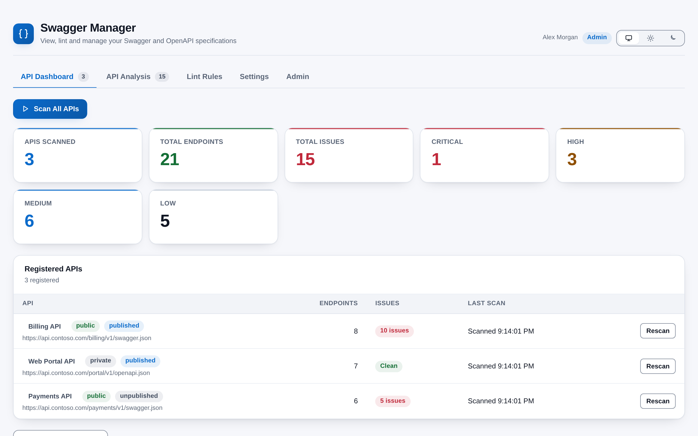
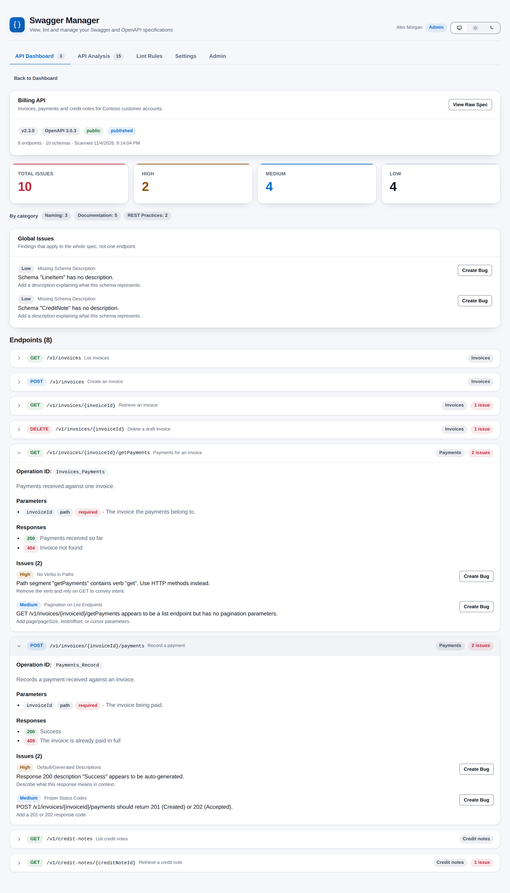

# Swagger Manager

**Is this API spec consistent, documented and safe to publish?** Swagger Manager fetches your Swagger and OpenAPI specifications, checks each one against 27 lint rules and shows the result as a dashboard, a filterable analysis and a per-endpoint detail view, with one-click Bugs for the problems it finds. It lives under **Pipelines > Swagger Manager** and runs entirely in your browser.

## What it checks

| Category | Rules | Examples |
|----------|-------|----------|
| Naming | 8 | camelCase path parameters, plural resources, kebab-case paths, no verbs in paths, no trailing slashes or file extensions, consistent casing |
| REST practices | 9 | correct HTTP verbs, no body on GET and DELETE, a body on POST, PUT and PATCH, sensible status codes, pagination on lists, versioning, nesting depth, consistent error responses |
| Documentation | 8 | placeholder descriptions such as "Success" or "A server side error occurred.", missing descriptions, summaries, tags and examples |
| Policy | 2 | a 0.x version that is public or published, a missing API description |

Every rule can be switched off or given its own severity (Critical, High, Medium or Low). Specs can be Swagger 2.0 or OpenAPI 3.x, in JSON or YAML.

## What you get

- **Dashboard** -- every registered API with its endpoint count, issue count and last scan, plus totals and a severity breakdown. Scan one API or all of them; cancel a full scan at any time.
- **Detail view** -- the spec header, a raw spec viewer, and every endpoint with its parameters, responses and findings.
- **Analysis** -- filter an API's findings by severity, category and text, grouped by path with the worst first.
- **Bugs from findings** -- create an Azure DevOps Bug from any finding with a pre-filled title and description, mapped severity and priority, an area path and an optional parent work item. The finding then links to the bug.
- **Discovery** -- find `swagger` and `openapi` files in your project's repositories and import them in one click.
- **Admin control** -- the first person to open the extension claims admin and can add others. Everyone else has a read-only view.
- **Keys kept out of the page** -- send an API key to your spec hosts, or read it at scan time from a Library variable group.
- **Looks like Azure DevOps** -- follows your light, dark or high-contrast theme, with a toggle to pin light or dark. Severities always carry a label, never colour alone, and both palettes meet WCAG AA contrast.

## How it works

1. Open **Pipelines > Swagger Manager**. The very first person to open it sees a setup page and can claim admin.
2. As an admin, add your spec URLs in **Settings**, or press **Discover APIs in Repositories** on the dashboard. Set an API key and header name if your endpoints need one.
3. Press **Scan All APIs**. The extension fetches each spec from your browser, three at a time, and lints it with the enabled rules.
4. Open an API to see its endpoints and findings, or use **API Analysis** to filter them. Press **Create Bug** on a finding to raise a work item.
5. Use **Lint Rules** to switch rules off or change their severity. Saved changes apply from the next scan.

## Permissions, in plain words

- **Project** -- a standard permission: the project is identified from the page you are on. You are identified from your Azure DevOps sign-in.
- **Identity (read)** -- to find people by name when an admin adds another admin.
- **Work items (read and write)** -- only to create a Bug when you press **Create Bug**, and to list the project's area paths for the dialog. The extension never edits, closes or deletes a work item; if you enter a parent ID, the new bug is linked under that work item.
- **Variable groups (read)** -- to list Library variable groups and read the one variable you choose as your API key.
- **Code (read)** -- to find and read spec files in your repositories for discovery.

## Privacy

All scanning happens in the browser inside the Azure DevOps page. The extension talks to your Azure DevOps organization and to the spec URLs your admins register, and to nothing else. There is no backend and no telemetry. It stores your settings, registered APIs, rule changes, scan summaries and the admin list in the Azure DevOps Extension Data Service for your organization, and your theme preference in your own browser. If you type an API key rather than use a variable group, it is saved in that same store as plain text, so prefer the variable group.

## Requirements

- Azure DevOps Services (the cloud service).
- A project with Pipelines enabled.
- Spec URLs that your browser can reach over HTTPS and that allow cross-origin requests from Azure DevOps.
- To create bugs, a project whose process has a Bug work item type (Agile, Scrum or CMMI).

## Support

Report problems or request features through GitHub Issues: https://github.com/adam-wheater/azure-devops-swagger-manager/issues

## License

Copyright © 2026 Adam Wheater. All rights reserved. This software is provided under a proprietary source-available license: you may read and audit the code and use the published extension, but you may not copy, modify, redistribute or republish it. See the LICENSE file for the full terms. The open source components it bundles keep their own licenses, listed in THIRD-PARTY-NOTICES.txt inside the package.
